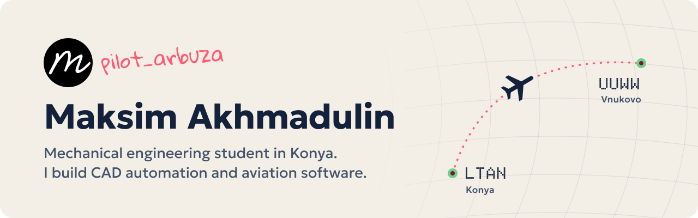

  

## About

I study mechanical engineering at Selçuk University in Konya, Türkiye, on a Türkiye Scholarship, and computer engineering by distance at SibSUTIS. In 2024 I reached the final of the 20th Aviation Olympiad run by the Sukhoi Design Bureau.

Most of what I build sits between mechanical engineering, aircraft and AI. Right now that means MCP (Model Context Protocol) servers and design pipelines for parametric CAD in SOLIDWORKS and Autodesk Fusion, plus RAG search over aviation manuals such as FCOM, QRH and MEL.

I also run my own Linux servers: a few VPS nodes with microservices behind Caddy and my own cloud storage.

## Projects

### [AnemosWorks](https://github.com/pilotarbuza/anemosworks)
A CAD automation engine and MCP server for SOLIDWORKS and Autodesk Fusion. It lets an AI client build parametric models, generate a feature tree from solid bodies, make drawings with standard tolerances and run engineering checks.

### [ANN (pilotann)](https://github.com/pilotarbuza/pilotann)
An aviation documentation assistant that runs as a Telegram Mini App and a PWA. It searches flight operations manuals by meaning, decodes METAR and TAF, and pulls flight plans from SimBrief.

### [Aviation cloud library](https://m.pilotarbuza.com)
An open collection of civil aviation documentation (Boeing, Airbus, regional jets) on my own Nextcloud server, with metadata indexed automatically.

### Fixed-wing UAV
My UAV project at Selçuk University. I model the aerodynamics, lift-to-drag ratio and structure in SOLIDWORKS and check them in Ansys.

### [Photography](https://photo.pilotarbuza.com)
Mountain trips and civil and military aircraft spotting in Russia, Türkiye and the Caucasus. The site is static, with full-size photos served from the Adobe Cloud CDN.

## Tools I use

- CAD and simulation: SOLIDWORKS, Autodesk Fusion 360, Ansys, AutoCAD, Inventor, GOST drafting
- Languages: Python 3.9+, TypeScript and JavaScript, Bash, SQL (SQLite), C/C++
- Infrastructure: Linux (Debian, Ubuntu), Caddy, systemd, Docker, self-hosted Nextcloud, Git
- Aviation: FCOM, QRH and MEL documents, aerodynamic simulation, SimBrief API, METAR decoding, MCP

## Education

- Selçuk University, Konya: BSc Mechanical Engineering, 2nd year (Türkiye Scholarships)
- SibSUTIS, Russia: BSc Computer Engineering, distance learning
- Sukhoi Design Bureau, 2024: finalist of the 20th Aviation Olympiad
- Languages: Russian (native), Turkish (C1, TÖMER), English (B2, EF SET)

## Contact

- Website: [pilotarbuza.com](https://pilotarbuza.com)
- Photos: [photo.pilotarbuza.com](https://photo.pilotarbuza.com)
- LinkedIn: [maksim-akhmadulin](https://www.linkedin.com/in/maksim-akhmadulin-969459440)
- Telegram: [@pilot_arbuza](https://t.me/pilot_arbuza), bot [@pilotann_bot](https://t.me/pilotann_bot)
- Email: akhmadulinmaksim@gmail.com
