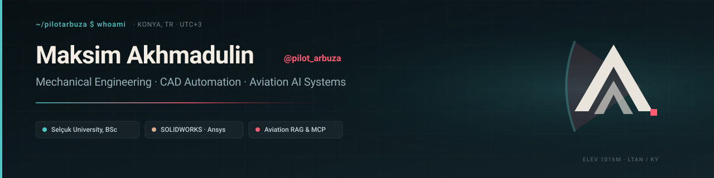

  

## About

Mechanical engineering student at Selcuk University (Konya, Türkiye; Türkiye Scholarships) and BSc Computer Engineering student at SibSUTIS. Finalist of the XX Aviation Olympiad by Sukhoi Design Bureau (2024).

I build at the intersection of mechanical engineering, aerospace systems, and AI automation. My core focus is developing Model Context Protocol (MCP) servers and automated design pipelines for parametric CAD (SOLIDWORKS and Autodesk Fusion), as well as building semantic RAG architectures for technical aviation documentation (FCOM, QRH, MEL).

Active Linux self-hoster: I design, deploy, and administer production microservices, reverse proxies (Caddy), and cloud storage infrastructure on independent VPS nodes.

---

## Flagship Projects

### [AnemosWorks](https://github.com/pilotarbuza/anemosworks)
AI automation engine and Model Context Protocol (MCP) server for SOLIDWORKS and Autodesk Fusion. Enables AI-assisted parametric modeling, CSG feature tree generation, technical drafting per standard tolerances, and engineering simulation checks.

### [ANN (pilotann)](https://github.com/pilotarbuza/pilotann)
Aviation documentation assistant, Telegram Mini App and PWA. Features semantic RAG search across flight operations manuals, automated METAR/TAF weather decoding, and SimBrief dispatch integration.

### [Aviation Cloud Library](https://m.pilotarbuza.com)
Structured open technical documentation repository for civil aviation (Boeing, Airbus, regional jets). Deployed on a self-hosted Nextcloud instance with automated metadata indexing.

### UAV Aerodynamic Design
Fixed-wing UAV development project at Selcuk University. Aerodynamic performance, lift-to-drag validation, and structural integrity modeled in SOLIDWORKS and verified in Ansys.

### [Photography & Visual Stories](https://photo.pilotarbuza.com)
Editorial landscape expeditions and civil/military aviation spotting across Russia, Turkey, and the Caucasus. Fast static architecture backed by high-resolution Adobe Cloud CDN delivery.

---

## Technical Stack

- **CAD & Simulation:** SOLIDWORKS, Autodesk Fusion 360, Ansys, AutoCAD, Inventor, GOST technical drafting
- **Languages & Backend:** Python 3.9+, TypeScript / JavaScript, Bash, SQL (SQLite), C/C++
- **Infrastructure & Systems:** Linux (Debian / Ubuntu), Caddy reverse proxy, systemd, Docker, Nextcloud self-hosting, Git / GitHub
- **Aviation & Protocols:** FCOM / QRH / MEL documentation systems, aerodynamic simulation, SimBrief API, METAR decoding, Model Context Protocol (MCP)

---

## Education & Recognition

- **Selcuk University (Konya, Türkiye):** BSc Mechanical Engineering (2nd year, Türkiye Scholarships)
- **SibSUTIS (Russia):** BSc Computer Engineering (distance)
- **Sukhoi Design Bureau (2024):** Finalist, XX Aviation Olympiad
- **Languages:** English (B2 · EF SET), Turkish (C1 · TÖMER), Russian (Native)

---

## Connect

- **Personal Portfolio:** [pilotarbuza.com](https://pilotarbuza.com)
- **Photography Gallery:** [photo.pilotarbuza.com](https://photo.pilotarbuza.com)
- **LinkedIn:** [linkedin.com/in/maksim-akhmadulin](https://www.linkedin.com/in/maksim-akhmadulin-969459440)
- **Telegram:** [@pilot_arbuza](https://t.me/pilot_arbuza) / [@pilotann_bot](https://t.me/pilotann_bot)
- **Email:** akhmadulinmaksim@gmail.com
